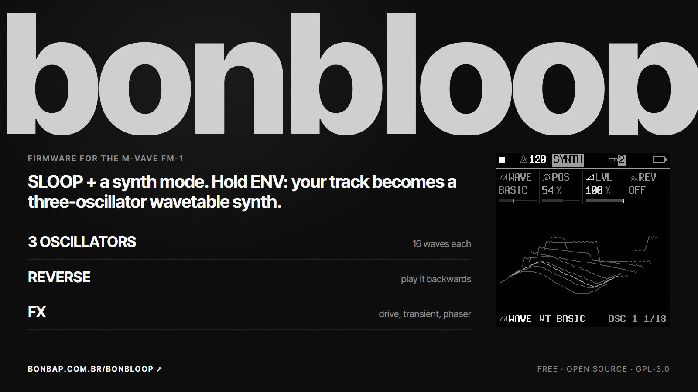

<p align="center"></p>

# BONBLOOP

**A groovebox firmware for the M-VAVE FM-1, built on SLOOP's code.** Three synth tracks and the drums, a step
sequencer and song mode — and on top of them a synth mode with three wavetable oscillators, effects in parallel with
an EQ and a soft clipper on every track, the scale lit on the keys, notes that end where you let go, and a look of its
own.

**[Install from the browser](https://bonbap.com.br/bonbloop/)** (Chrome or Edge, the FM-1 on USB) ·
**[Guia completo em português](BONBLOOP.md)** · [Web editor](https://bonbap.com.br/bonbloop/webapp/editor/)

> **Version 1.0** — the first official release ([release notes](../../releases/tag/v1.0)). Custom firmware is
> installed at your own risk, with no warranty.

---

## What it is

BONBLOOP is a fork of [SLOOP](https://github.com/isod89/sloop-fm1) (by isod89), which grew out of
[Felucca](https://github.com/hugelton/Felucca) (by Leo Kuroshita, Hügelton Instruments), the open firmware for the
FM-1. From SLOOP it keeps the live four-track groovebox — the layers, the drums, the twelve engines, the sequencer,
song mode, MIDI, USB audio and the web editor — and builds its own instrument on it.

## What BONBLOOP adds

**Synth mode.** Hold **ENV** for about 0.7 s and the selected track becomes a three-oscillator synth on the **WAVE**
engine (hold ENV again to leave):

- Each oscillator plays SIN, TRI, SAW, SQR, NOISE or one of ten wavetables, with a position (POS), a level and
  **reverse**; OSC 2 and 3 tune in semitones and cents.
- **An envelope and an LFO for each oscillator**, a filter (LP, BP, HP), voice modes (POLY, MONO, LEGATO, UNISON) and
  glide.
- **An FX chain you build**, up to seven effects in the order you choose: a Decapitator-style **drive** (five
  styles: tape, tube, transformer, triode, pentode), phaser, DJ filter, 4-band **EQ**, chorus, delay (in note values
  or in ms) and reverb. Every effect's page starts with its level on KNOB 1 — **MIX** (dry / wet) for the drive,
  phaser and filter, **SEND** for the chorus, delay and reverb — the same value as its fader on the **FX MIX** page.
- **16 WAVE sounds**, and the **PRESET** page saves yours into the user slots.

**Effects on every track.**

- A **mixer** per track: DST, MOD, DLY and REV beside the dry sound (in parallel, not in series).
- **A 4-band EQ** per track and on the drums, drawn as its curve.
- **A soft clipper** per track and on the drums: SOFT, HARD or FOLD, with its transfer curve, ceiling and IN / OUT
  meters on screen.
- A glue **COMP** on the master, with its meters.
- **OCT− + OCT+** on an effect's page puts that effect back to its default; **NEW** clears every effect.

**Notes that end where you let go.** Recording (live or a free take) keeps where each key was released, to 1/8 of a
step, and never plays a note shorter than you held it. **SEQ → NOTES → LEN** shows and edits a note's length in
milliseconds.

**The scale on the keys.** **GLOBAL → SCALE** lights a key's notes on the FM-1's keys (ROOT, SCALE, LIGHT up to full
brightness, MARK the root or 1-3-5). Lights only: what you play is untouched, and they step aside while a layer is held.

**Drums.** The synth's drive and the soft clipper on the drum bus, and a **REPEAT that locks on**: hold ARP alone and
it stays on, so KNOB 1 changes its rate while you play.

**Chords.** Voicings on SEL (inversions, drop 2 and 3, spread, +bass); every triplet on the arp and the delay.

**One look.** The **Pixelify Sans** pixel font and Pantone **Very Peri** on black — the only palette. Knobs only where
the value is a sound (a level, a time, a cutoff); value windows where you choose something; violet for what is on.

**Its own identity: `FM-1_962`.** The update loader is Felucca's: an interrupted install resumes, and any other FM-1
firmware installs over BONBLOOP again.

## Install

### From the browser

1. Open **[bonbap.com.br/bonbloop](https://bonbap.com.br/bonbloop/)** in **Chrome or Edge** on a computer.
2. Connect the FM-1 straight to the computer with a USB **data** cable (no hub).
3. Press **INSTALL**, allow MIDI (SysEx) when asked, and wait for *Done* (about a minute). Do not unplug while it
   writes. The FM-1 restarts on the BONBLOOP logo.

Your projects, user presets, samples and settings stay on the FM-1. Back them up with the web editor first anyway
(Projects → Backup).

### From the command line

```
python tools/fm1_install.py bonbloop-<version>.fwsc
```

(needs `pip install mido python-rtmidi`; the package is in `docs/firmware/`, or build it yourself, below.)

### Going back, and rescue

- **To SLOOP or another firmware:** install it as its own page says. SLOOP opens BONBLOOP's projects, without the
  synth's extras (a WAVE track falls back to that track's default sound there).
- **To the official firmware:** M-VAVE's updater **M-UPGRADE** (m-vave.com → Downloads → PC Software) with the
  official FM-1 firmware. If it does not find the FM-1, close every other app or tab that uses MIDI.
- **An install was cut off:** the FM-1 waits in update mode; press INSTALL again and it finishes.
- **The FM-1 does not start BONBLOOP:** hold **OCT−** alone while switching it on (USB rescue), then install again.
  If it does not start at all, recovery needs [FM-1-transporter](https://github.com/kurogedelic/FM-1-transporter).

## First minutes

1. **Drums:** ALGORITHM to track 4; the white keys are 16 sounds, PRESETS picks a kit. Press **REC**, play a beat,
   press REC again on the "1" after your last bar: the loop closes and its length sets the tempo.
2. **Synth:** ALGORITHM to track 1 and **hold ENV**. Turn the knobs on **OSC 1**; tap **EDIT** for OSC 2, OSC 3 and the
   filter, **ENV** and **LFO** for each oscillator's envelope and LFO.
3. **FX:** tap **FX** for the **FX CHAIN**: put a DRIVE and a REVERB in the slots, then set how much of each on **FX
   MIX**. Each effect's own page follows in the FX group.
4. **Record a line:** **REC** while it plays; hold the notes as long as you want them. In **SEQ → NOTES**, KNOB 3
   (LEN) fine-tunes a note's end in ms.
5. **See the key:** **GLOBAL → SCALE**, LIGHT to MAX: the notes of the key light up on the keys.
6. **Save:** SAVE → **SECTION**: pick A–D with KNOB 1, then SAVE (KNOB 4) or LOAD (KNOB 3). A LOAD or a NEW is kept in
   flash at once, so the FM-1 switched off right after comes back with it.
7. A mistake? **EDIT + OCT−** is undo, **EDIT + OCT+** redo.

## The controls

| Control | What it does |
| --- | --- |
| **MASTER** | volume (and the USB audio level when USB AUDIO is on MASTER) |
| **SELECT** | on HOME and in a layer: the tempo · on a page: the previous / next page of its group |
| **ALGORITHM** | the selected track: 1 · 2 · 3 (synths) · 4 (drums) |
| **PRESETS** | the selected track's sound, or the drum kit |
| **KNOB 1–4** | the four values at the bottom of the screen |
| **OCT− / OCT+** | octave (both: back to 0; on an effect's page: that effect to its default) · on the drum track, held: ghost / hard hits |
| **FX · SEL · ENV · LFO · EDIT · GLO** | tap: their pages · hold: a layer (FX punch-in, SEL key and chords, EDIT erase, GLO mute / solo / fill) · **hold ENV: synth mode** |
| **HOME** | the TRACKS screen · on it: the full-screen visualiser (11 styles) · hold: the menu · tapped while a layer is held: lock it |
| **SAVE** | the project and song pages · hold: the song layer (sections A–D) |
| **ARP · SEQ** | tap: their pages · hold: note repeat (on the drums: hold ARP alone to lock REPEAT) · step entry |
| **PLAY · REC** | start / stop · record now (playing) or arm (stopped); hold REC: clear the track |

## The menu

Hold **HOME**. **SELECT** moves between the sections, **KNOB 1–4** set their rows, **OCT+** opens or steps the row
under the cursor, **OCT−** closes. These are settings of the FM-1, kept apart from the projects.

| Section | Rows |
| --- | --- |
| **SCREEN** | ZOOM (a large readout of the value you turn) · KNOB ACCEL (a fast turn sweeps wider) |
| **LIGHTS** | LIGHTS (the buttons glow, 3 levels) · KEYS (C keys, white keys or all keys glow) · NOTES (the notes playing light their keys) |
| **AUDIO** | SPEAKER LOWCUT · USB AUDIO (MASTER / FULL) · USB RATE (AUTO / 44.1 / 48 kHz) · FILTER RESO |
| **SEQ** | STEP ADVANCE · DRUM PREVIEW |
| **SYSTEM** | 2ND CORE · HARDWARE CALIBRATION · MIDI LEARN CLEAR · ABOUT (the version) |

## Projects and compatibility

- **Autosave:** the working project is kept in flash when the transport is stopped and the panel has been quiet for
  2.5 s; a LOAD or a NEW is kept at once. At power-on BONBLOOP comes back as you left it.
- **Four sections A–D** (a song), **32 user presets**, undo / redo, and a **full backup and restore** in the web
  editor.
- BONBLOOP opens SLOOP's projects, user presets, samples and settings as they are. Its own extras (the oscillators'
  envelopes and LFOs, the FX chain, the EQs and clippers, the note ends) live in a side record next to each project:
  SLOOP and older BONBLOOP builds open the project without them.
- Other firmwares may not read the FM-1's saves, or may overwrite them: **back up first**, whichever way you switch.

## MIDI and USB audio

- **MIDI in** over USB and the 3.5 mm TRS jack (through a TRS-to-DIN adapter): channels 1–3 play the synth tracks, 10
  the drums, the others the selected track (GLOBAL → MIDI sets any channel per track). Sustain pedal, pitch bend,
  the standard CC map (level, pan, filter, envelope, glide, sends) and **MIDI LEARN** (GLO + F#3).
- **MIDI out:** the keys always; the sequencer, arp and rolls too with GLOBAL → MIDI 2 → OUT = SEQ.
- **MIDI clock in** over USB or TRS (GLOBAL → SYSTEM → SYNC).
- **USB audio:** the FM-1 is a class-compliant audio input (the master output, 16-bit stereo, 44.1 or 48 kHz), no
  driver, on the same cable as MIDI and the editor.

## The web editor

**[bonbap.com.br/bonbloop/webapp/editor](https://bonbap.com.br/bonbloop/webapp/editor/)** in Chrome or Edge, the
FM-1 on USB, then **Connect**: every sound parameter, the sequencer (tiles or piano roll, MIDI file import / export),
the tracks, the song, your presets, the sample slots with CHOP, the drum synth, and backup / restore. It also
downloads as one file that works offline, or installs as an app (Android too). The protocol is in
[web/EDITOR_PROTOCOL.md](web/EDITOR_PROTOCOL.md).

## Building and tests

The JieLi toolchain and three files of the AC79 SDK, as in [BUILDING.md](BUILDING.md). On Windows with WSL:

```
python tools/build_windows.py --distro Ubuntu --toolchain /root/.jieli/toolchain --sdk build/deps/ac79 --slice 0
python tools/fm1_install.py build/felucca.fwsc
```

`tests/run_tests.sh` runs the host test suite with no hardware: audio renders against golden hashes, the
sequencer's timing, recording and note ends, the UI pages and layers, the synth mode, flash storage and power cycles,
the update loader, MIDI, and the web pages. `web/make_site.py` builds the site in `docs/`.

## Documentation

- [BONBLOOP.md](BONBLOOP.md) — the complete guide, in Portuguese: every page of the synth mode, the effects, the
  scale, recording, and the notes of each development step
- [BUILDING.md](BUILDING.md) — building, build options and tests
- [web/EDITOR_PROTOCOL.md](web/EDITOR_PROTOCOL.md) — the editor's SysEx protocol
- [LICENSING.md](LICENSING.md) — the licences of the code and the assets
- SLOOP's own manuals, for what BONBLOOP inherits: [GUIDE.md](GUIDE.md), [SLOOP.md](SLOOP.md)

## Credits

- **BONBLOOP** — henribon ([bonbap](https://bonbap.com.br/)).
- **[SLOOP](https://github.com/isod89/sloop-fm1)** by **isod89** and its contributors — the groovebox BONBLOOP is
  built on; its README lists everyone who made it.
- **[Felucca](https://github.com/hugelton/Felucca)** by **Leo Kuroshita** (@kurogedelic), **Hügelton
  Instruments** — the firmware at the root of both: the engines, the sequencer, the editor, the installer and the
  update loader.
- Samples: Versilian Studios VSCO-2 Community Edition and VCSL, and the Sonic Pi samples (CC0 1.0); the free
  user-slot pack in `assets/hiphop-pack` adds Wurlitzer EP200 samples by Greg Sullivan (CC BY 3.0,
  `assets/hiphop-pack/CREDITS.txt`).
- Fonts: Pixelify Sans (The Pixelify Sans Project Authors, SIL OFL 1.1) on the FM-1's screen; Terminus (SIL OFL 1.1)
  in the editor. Icons: Fukiai (MIT, Hügelton Instruments). The FM6 engine uses msfa from Dexed (Apache-2.0).

## Licence

Code: GPL-3.0-only (see [LICENSE](LICENSE), and [LICENSING.md](LICENSING.md) for the assets). No warranty. M-VAVE and
FM-1 are trademarks of their owners; BONBLOOP, SLOOP and Felucca are not affiliated with M-VAVE.
